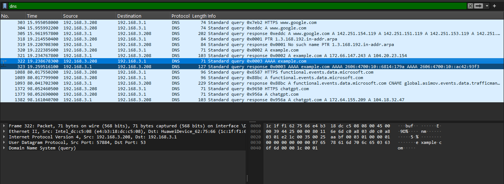
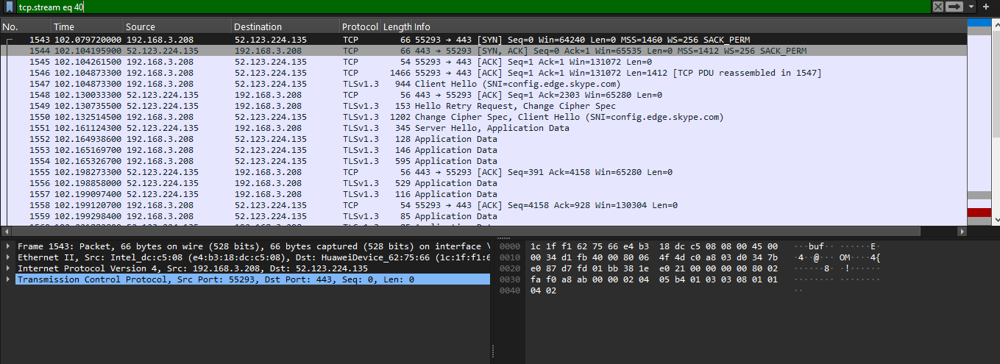
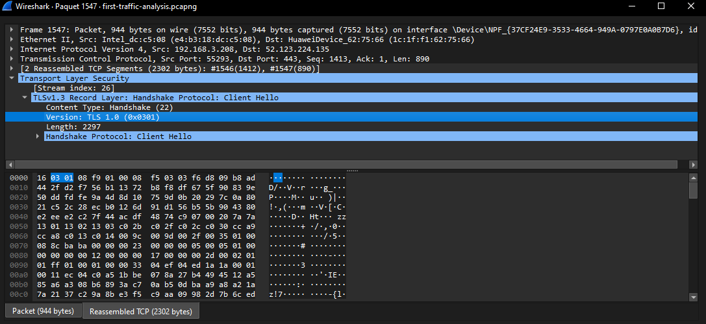
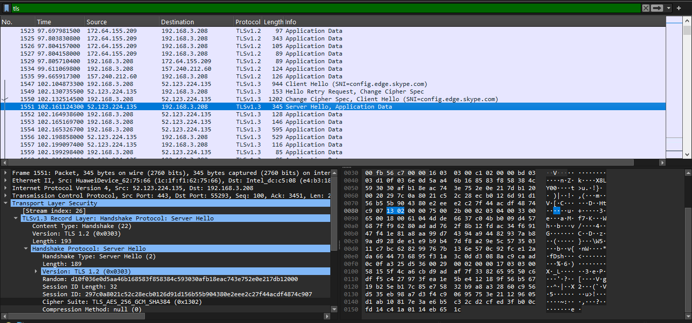
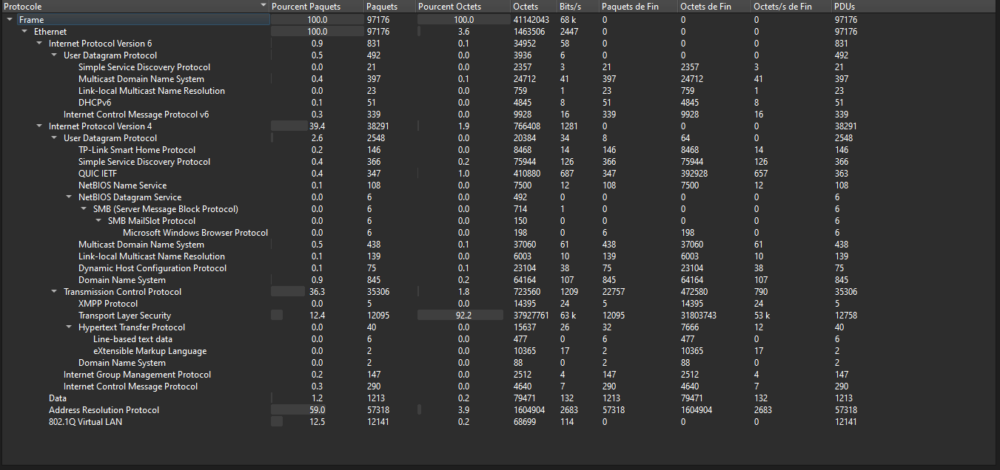
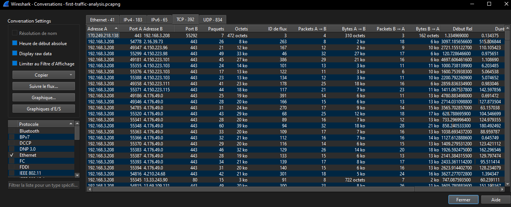
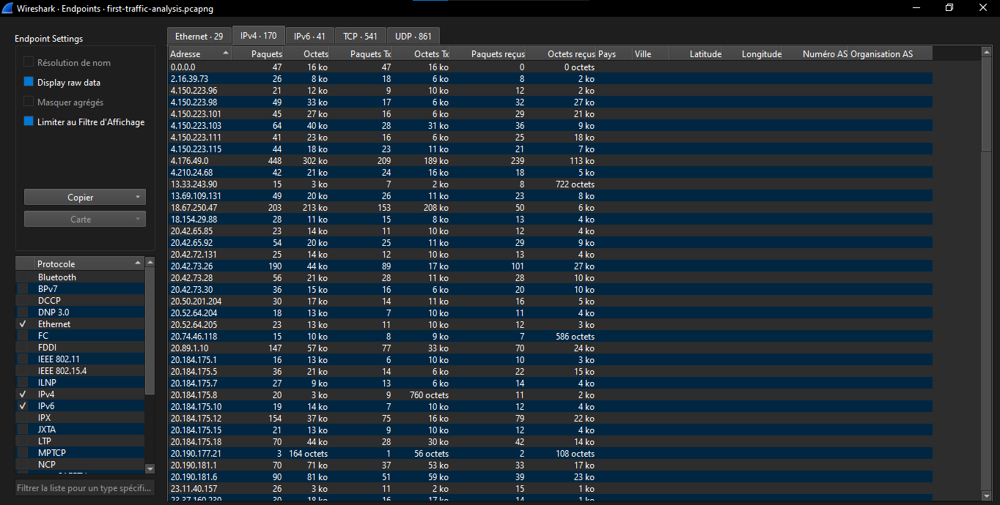

# Wireshark Network Traffic Analysis

A hands-on cybersecurity project focused on network traffic analysis using Wireshark.

## Project Objectives

- Analyze DNS queries and responses.
- Identify the TCP three-way handshake.
- Inspect TLS 1.3 negotiation and cipher suites.
- Explore protocol hierarchy, TCP conversations, and network endpoints.
- Document findings with packet-level evidence and screenshots.

## Tools and Environment

- Wireshark
- Windows
- `curl.exe` for generating HTTPS test traffic
- Display filters for DNS, TCP, and TLS

## Lab Results

| Analysis | Observation |
|---|---|
| DNS | Query for `example.com`, type A, and response observed |
| TCP | SYN, SYN-ACK, and ACK observed |
| TCP stream | Stream 40 |
| Server port | 443 |
| TLS version | TLS 1.3 |
| Cipher suite | `TLS_AES_256_GCM_SHA384 (0x1302)` |
| Captured packets | 97,176 |
| TCP packets | 35,306 |
| TLS packets | 12,095 |
| TCP conversations | 392 |
| IPv4 endpoints | 170 |

The protocol statistics describe the complete capture, which may include background network traffic. They do not represent only the test connection.

## Screenshots

### DNS Analysis


### TCP Three-Way Handshake


### TLS 1.3 Client Hello


### TLS 1.3 Server Hello


### Protocol Hierarchy


### TCP Conversations


### Network Endpoints


## Useful Display Filters

```text
dns
tcp.stream eq 40
tcp.stream eq 40 && tls.handshake.type == 1
tcp.stream eq 40 && tls.handshake.type == 2
```

## Report

See [`reports/first-analysis.md`](reports/first-analysis.md) for the detailed analysis.

## Security and Privacy

Raw PCAP/PCAPNG files are intentionally excluded from version control because captures can contain IP addresses, hostnames, and other sensitive network metadata.

Only publish screenshots and reports after reviewing them for sensitive information.

## Limitations

This lab demonstrates protocol inspection. The observations alone do not prove that a network is secure or that an attack occurred.

## Future Improvements

- Investigate unusual traffic patterns.
- Document suspicious indicators with supporting packet evidence.
- Add sanitized sample captures and reproducible analysis steps.
- Expand the report with additional defensive detection examples.

## Author

Cybersecurity and Data Science portfolio project.
